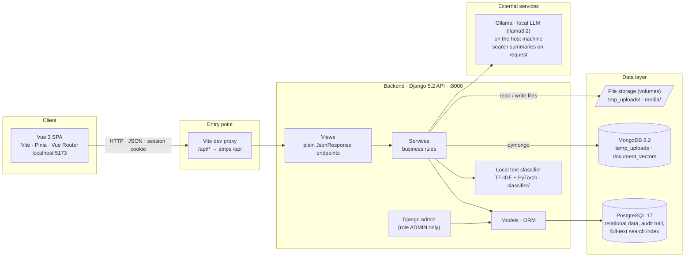
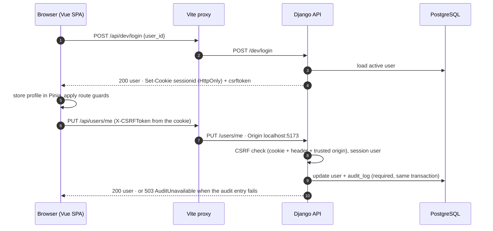
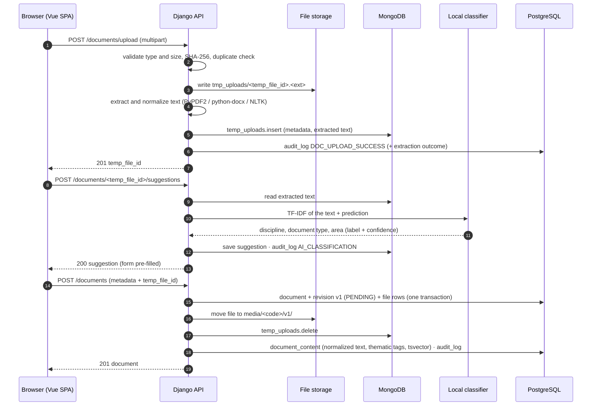
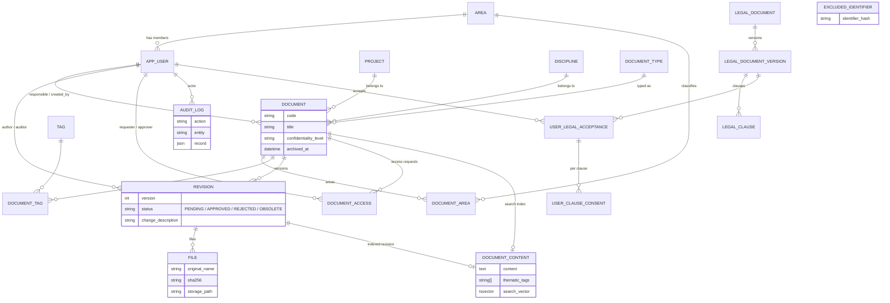
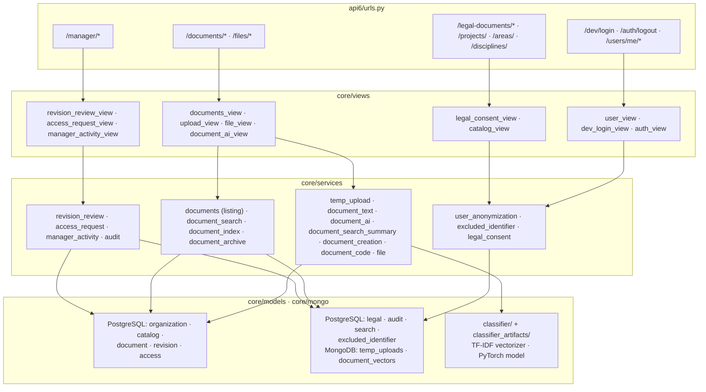

# System Architecture <a id="system-architecture"></a>

Visual guide to how Índice is put together: the Vue frontend, the Django API, the data stores and the external services, and how they talk to each other. The diagrams are written in [Mermaid](https://mermaid.js.org/) directly in this file, so GitHub renders them and every change goes through a pull request like code. SVG exports of each diagram live next to this file for slides and documents that cannot render Mermaid.

- [1. Overview](#overview)
- [2. Technology stack](#technology-stack)
- [3. Frontend and backend communication](#communication)
- [4. Main flows](#main-flows)
- [5. Data layer and search sources](#data-layer)
- [6. Module map](#module-map)
- [7. Delivery and CI](#delivery)
- [How to update the diagrams](#how-to-update)

## 1. Overview <a id="overview"></a>

Índice is a single-page application that talks to a JSON API. Everything runs on the developer's machine: the API, PostgreSQL and MongoDB are Docker Compose containers, the frontend runs on the Vite dev server, metadata suggestions come from a text classifier that ships with the backend, and the only service outside Compose is Ollama, a local LLM used to summarize search results.



SVG export: [overview.svg](./overview.svg)

## 2. Technology stack <a id="technology-stack"></a>

| Layer | Technology | Role |
|---|---|---|
| Frontend | Vue 3, Vite, Pinia, Vue Router, `docx-preview`, Vitest, ESLint/Prettier | SPA served by the Vite dev server on `:5173`; the `/api` proxy forwards calls to the backend and strips the prefix, so routes live at the API root. |
| Backend | Python 3.12, Django 5.2, `django-cors-headers`, plain `JsonResponse` views (no Django REST Framework) | API, authentication (Django sessions + CSRF), business rules, Django admin. |
| Relational database | PostgreSQL 17 (`psycopg` 3 with a connection pool), extensions `unaccent` and `pg_trgm` | Users, areas, catalogs, documents, revisions, files, access requests, legal terms, audit trail and the full-text search index. |
| Document database | MongoDB 8.2 (`pymongo`) | `temp_uploads`: metadata, extracted text and suggestion of files uploaded but not yet registered; `document_vectors`: TF-IDF vectors of the classifier's training dataset, written by `classifier.vectorize` and read by `classifier.train`. |
| File storage | Local volumes `tmp_uploads/` (temporary) and `media/` (definitive, `DOCUMENT_STORAGE_DIR`) | The bytes of every revision file, served through `GET /files/<id>/view`. |
| Text processing | PyPDF2, python-docx, NLTK (stopwords bundled in the image) | Text extraction, normalization, thematic tags for the search index. |
| Machine learning | Local text classifier: scikit-learn TF-IDF + PyTorch network (`classifier/` package, trained artifacts in `classifier_artifacts/`) | Suggests discipline, document type and area from the extracted text, without leaving the server. |
| LLM | Ollama on the host machine (`llama3.2` by default, `OLLAMA_BASE_URL`) | Summarizes the highlighted snippets of a search on request (`POST /documents/search/ai-summary`); answers a fallback summary when unreachable. |
| Infrastructure | Docker Compose, GitHub Actions | Local environment and CI (build, lint, tests, commit lint) in both repositories; Ollama runs outside Compose; no published environment yet. |

## 3. Frontend and backend communication <a id="communication"></a>

**Transport.** The frontend calls `/api/<route>`; the Vite proxy forwards it to `http://localhost:8000/<route>`, so the browser only ever talks to one origin. Requests and responses are JSON (`Accept: application/json`), except the upload (`multipart/form-data`, sent with `XMLHttpRequest` to report progress) and the file viewer (binary stream). Errors follow two shapes: `{"error": "<Name>"}` for a single condition (`DocumentNotFound`, `PermissionDenied`, `AuditUnavailable`...) and `{"errors": {"<field>": {"code", "message"}}}` for validation. Unexpected failures answer `500 {"error": "<ExceptionName>"}` with the details only in the server log (LGPD).

**Authentication and authorization.**

- The session is a Django session: the backend sets an `HttpOnly` `sessionid` cookie and a `csrftoken` cookie. Until the real login exists, the frontend opens the session through the provisional `POST /dev/login {"user_id"}` (available only with `DJANGO_DEBUG` on) and closes it with `POST /auth/logout`.
- Django's CSRF protection stays on: every write (`POST`, `PUT`, `DELETE`) carries the `csrftoken` cookie value in the `X-CSRFToken` header, added automatically by the API client (`src/api/client.js`), and `DJANGO_CSRF_TRUSTED_ORIGINS` / `DJANGO_CORS_ALLOWED_ORIGINS` list the frontend origins.
- Roles live in `app_user.role`: `AUTHOR` and `VIEWER` are collaborators; `AUDITOR` and `ADMIN` are technical managers (they review revisions, decide access requests, archive documents and read the activity feed). `ADMIN` also enters the Django admin. The frontend mirrors this with the `managerOnly` / `collaboratorOnly` route guards and the `public` flag of the login route.
- Reading a document's content is a separate rule, checked on the server for the detail and for every file: the responsible user, a user with an approved access request, or a manager while the revision is pending.

**Who calls what.**

| Frontend screen (route) | API endpoints |
|---|---|
| Login (`/login`) | `POST /dev/login`, `GET /users/me` |
| Home and results (`/home`, `/results`) | `GET /documents` (filters, pagination), `GET /documents/simple-filters`, `GET /documents/search` |
| Documents list and details (`/documents`, `/documents/:id`) | `GET /documents`, `GET /documents/<id>`, `GET /files/<id>/view`, `POST /documents/<id>/request-access` |
| New document (`/documents/upload` → `/metadata` → `/confirmation`) | `POST /documents/upload`, `POST /documents/<temp_file_id>/suggestions` (local classifier), `GET /projects/`, `GET /disciplines/`, `GET /areas/`, `GET /documents/types`, `POST /documents` |
| New revision (`/documents/:id/new-revision`) | `POST /documents/<id>/revisions` |
| Manager panel (`/revisions`) | `GET /manager/pending-revisions`, `POST /manager/revisions/<id>/decision`, `GET /manager/pending-access-requests`, `POST /manager/access-requests/<id>/decision`, `GET /manager/activities` |
| Profile / data subject management (`/profile`) | `GET`/`PUT /users/me`, `POST /users/me/request-deletion`, `GET /legal-documents`, `GET /legal-documents/versions/<id>`, `GET`/`POST /users/me/legal-acceptances`, `POST /users/me/legal-acceptances/<id>/revoke`, `POST /auth/logout` |
| Not called by the frontend yet | `GET /health/`, `/admin/`, `DELETE /documents/<id>`, `GET /documents/archived`, `POST /documents/<id>/restore` (archiving has no screen yet), `POST /documents/search/ai-summary` (search summary) |

The full contract of every endpoint is documented in the [backend README](../../README.md).

## 4. Main flows <a id="main-flows"></a>

### Sign in and a protected write



SVG export: [flow-sign-in.svg](./flow-sign-in.svg)

### Registering a document (the ingestion pipeline)



SVG export: [flow-registration.svg](./flow-registration.svg)

### Other flows

| Flow | What happens |
|---|---|
| New revision | `POST /documents/<id>/revisions` creates revision `n+1` as `PENDING` with its files, re-indexes the content and writes the audit event. Only the latest approved revision is the official one. |
| Revision review | A manager lists `GET /manager/pending-revisions` and decides with `POST /manager/revisions/<id>/decision`: approval makes the revision current and the previous one `OBSOLETE`; rejection requires a justification. Managers cannot decide their own revisions. |
| Access to a document | Everyone sees the public metadata. Reading the description and files requires being the responsible user or holding an approved access request (`POST /documents/<id>/request-access`, decided by a manager); every denied file read is audited. |
| Archiving | `DELETE /documents/<id>` is a soft delete by a manager of one of the document's areas; archived documents disappear from every listing and search and can be restored. |
| Search | `GET /documents` filters by metadata; `GET /documents/search` runs PostgreSQL full-text search over title, code, description, tags and, for users who can read the document, the indexed content, with highlighted snippets; `POST /documents/search/ai-summary` asks Ollama for a short summary of those snippets (a fallback text when the model is unreachable). |
| Data subject rights (LGPD) | `GET`/`PUT /users/me`, account deletion with anonymization, consent per clause of the legal terms with revocation and re-acceptance, and a blacklist of hashed identifiers that blocks re-registration. |
| Traceability | Sensitive actions write to the append-only `audit_log` inside the same transaction (`503 AuditUnavailable` otherwise). `GET /manager/activities` turns the trail plus the ingestion outcomes into the manager's activity feed. |

## 5. Data layer and search sources <a id="data-layer"></a>

### Relational model (PostgreSQL)



SVG export: [data-model.svg](./data-model.svg)

Notes on the data layer:

- `audit_log` is append-only at the database level (a trigger rejects `UPDATE` and `DELETE`), and `document.updated_at` is maintained by a trigger. Enumerations are guarded by `CHECK` constraints.
- `excluded_identifier` stores only an HMAC-SHA256 of the email of removed accounts, so the identifier can never be reused without storing readable personal data.
- `temp_uploads` in MongoDB is transient: a record exists between the upload and the registration (or until the temporary file is discarded) and holds the metadata, the extracted text and the suggestion. `document_vectors` holds the TF-IDF vectors of the classifier's training dataset, tagged with the vectorizer version; the trained model itself (`model.pt`, `vectorizer.joblib`, `metadata.json`) is versioned in `classifier_artifacts/` and loaded in memory by the API.
- File bytes never go to a database: temporary files stay in `tmp_uploads/`, registered files in `media/<document code>/v<version>/`, both Docker volumes.

### Search sources

| Source | Where | What it answers |
|---|---|---|
| Metadata filters | PostgreSQL (`document`, `revision`, catalogs, trigram indexes on title and code) | `GET /documents`: text on title/code/description/tags, type, area, discipline, status, responsible, dates, pagination. |
| Full-text search | PostgreSQL `document_content.search_vector` (GIN index, configuration `portuguese_unaccent`: Portuguese stemming without accents) plus a metadata vector built per query | `GET /documents/search`: ranked results, highlighted snippets; the content and the thematic tags only count for users who can read the document. |
| Catalogs | PostgreSQL (`project`, `discipline`, `document_type`, `area`, `tag`) | Form options, simple filters and the project → discipline dependency. |
| Metadata suggestions | Local classifier (TF-IDF + PyTorch, `classifier/`) over the text kept in MongoDB | Pre-fills discipline, document type and area in the form; an aid to classification, not a search source; its outcome is recorded in the audit trail. |
| Search summaries | Ollama (local LLM) over the highlighted snippets of a search | `POST /documents/search/ai-summary` returns a short summary of what the results say about the query; not called by the frontend yet. |

## 6. Module map <a id="module-map"></a>

**Backend (`backend/core/`)**, organized by layer: `views/` (one module per resource, HTTP only), `services/` (business rules, one topic per module), `serializers/` (model ↔ JSON), `models/` (entities grouped by subject: organization, catalog, document, revision, access, legal, audit, search), `management/` (`seed`, `ensure_superuser`, `index_documents`, `delete_user`), `migrations/` (0001 creates the schema, 0002 the database triggers) and `tests/`. Routes are registered in `api6/urls.py`. The classifier is a separate package at the repository root (`classifier/`: vectorize, train, predict) with its trained artifacts in `classifier_artifacts/`.



SVG export: [backend-modules.svg](./backend-modules.svg)

**Frontend (`frontend/src/`)**: `views/` (login, home, document, manager, user-management), `components/` (common, layout, document-upload), `api/` (one module per backend resource: `auth`, `users`, `documents`, `manager`, `legal`, `projects`, `disciplines`, `areas`, on top of `client.js`), `stores/` (Pinia: `authStore`, `documentFormStore`, `uploadStore`, `searchStore`, `notificationStore`), `router/` (routes and guards) and `tests/`.

## 7. Delivery and CI <a id="delivery"></a>

- **Hosting**: there is no published environment yet. The reference environment is the Docker Compose stack of the backend repository plus the Vite dev server of the frontend, on the developer's machine; when the system is deployed, a reverse proxy will take the place of the Vite proxy in front of the API and the built SPA.
- **Local environment**: `docker compose up` in the backend repository starts `postgres` (`:5433` on the host), `mongodb` (`:27018`) and `api` (`:8000`, runs `migrate` and `ensure_superuser` on start); `npm run dev` in the frontend repository starts Vite on `:5173`; Ollama is installed on the host (`ollama pull llama3.2`) and reached through `OLLAMA_BASE_URL`. Configuration comes from `.env` (generated by `scripts/setup_env.py`), never committed.
- **Branching**: Gitflow in every repository (`main`, `develop`, `<type>/<card>-description` branches), Conventional Commits with the card id, pull requests reviewed by a teammate and merged only with a green pipeline. See [Branch Strategy](https://github.com/Pragma-Co/indice/blob/main/documentation/process/Branch%20Strategy.md) and [Commit Standards](https://github.com/Pragma-Co/indice/blob/main/documentation/process/Commit%20Standards.md) in the documentation repository.
- **CI (GitHub Actions)**, on pull requests to `develop` and `main`: backend runs Ruff (lint and format), the Docker image build with `django check`, the test suite against a PostgreSQL service and the commit message lint; the frontend runs build, ESLint/Prettier, Vitest and the commit message lint.

## How to update the diagrams <a id="how-to-update"></a>

Edit the Mermaid block in this file; GitHub renders it on save. To refresh the SVG exports, run from this folder (requires Docker):

```bash
for name in overview flow-sign-in flow-registration data-model backend-modules; do
  docker run --rm -u "$(id -u):$(id -g)" -v "$PWD:/data" minlag/mermaid-cli \
    -i "/data/$name.mmd" -o "/data/$name.svg"
done
```

The `.mmd` files are the same blocks as in this README; keep both in sync in the same pull request.
